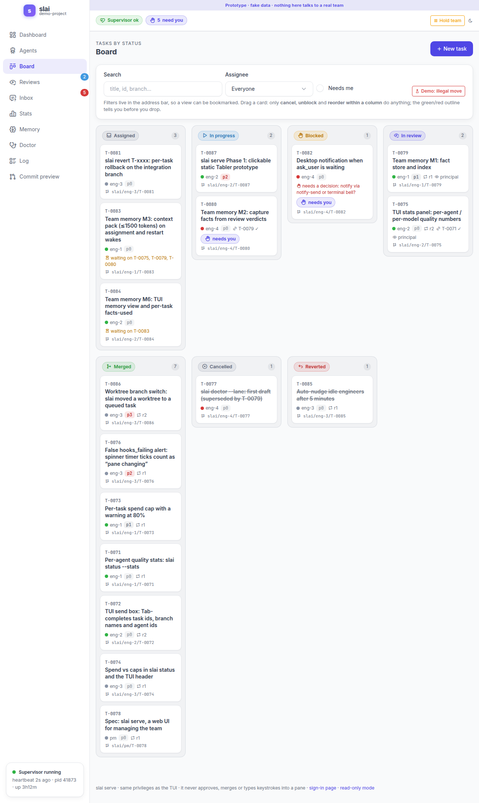

# `slai serve`: the team in a browser

`slai serve` opens your team in a web page: who is working on what, the task board, the
reviews waiting for the principal, the questions the team has for you, spend, health checks,
the event log and the team's memory. It uses the same data and the same functions as the TUI
and the CLI, so it never knows more or can do more than they can.



<!-- TODO(orch): replace with real screenshots when W8 / T-0107 adds them. The image above is
from the static prototype (docs/serve-prototype/), not the running UI. -->

## Start it

```bash
slai serve                                         # 127.0.0.1 on a random port; prints the URL
slai serve --listen 127.0.0.1:8080                 # a fixed port
slai serve --read-only                             # look, don't touch: every write is refused
slai serve --listen 0.0.0.0:8080 --insecure-http   # reachable from your network (trusted LAN only)
```

| Flag | What it does |
| --- | --- |
| `--listen host:port` | Where to listen. Default `127.0.0.1:0`, a free loopback port. |
| `--insecure-http` | Required for a non-loopback `--listen`: you acknowledge the page is plain HTTP. It does **not** turn off sign-in or any check. |
| `--allow-host host[:port]` | Also accept this exact `Host` header, for a name in front of the server (a reverse proxy). Repeatable. The Origin and session checks stay on. Without it only the bound address (and, on loopback, `localhost`) is accepted. |
| `--read-only` | Every write answers 403 and the pages show no write controls. |

There is no flag that turns authentication off, and no environment variable either.

`slai serve` is a **separate process** from the supervisor. It opens `.slai/state.db` the way
`slai status` does and never starts a supervisor. Without `slai up` (or the TUI) it still shows
the team and takes messages, and a banner says "the supervisor is not running", so nothing you
queue is delivered until one runs.

### Signing in

On loopback it prints `slai serve: open http://127.0.0.1:PORT/`. Open it; the first visit
creates your session and you are in. The session cookie lasts 12 hours.

The automatic session applies only to a **plain loopback request**: one whose own `Host` is
`127.0.0.1`, `localhost` or `[::1]` and that carries no `X-Forwarded-For`, `X-Forwarded-Host`,
`X-Forwarded-Proto`, `Forwarded` or `X-Real-IP` header. A request that came through a reverse
proxy, or by an `--allow-host` name, does the token exchange exactly like a non-loopback bind,
and `slai serve --allow-host NAME` prints that token URL at start.

With a non-loopback `--listen` it prints a URL that carries a one-time token:

```
slai serve: open http://<this machine's address>:8080/?token=9f2c…
```

Open that URL once. The page exchanges the token for a session cookie and removes it from the
address bar; the token is never read from a query string again. A visitor without the token
(or a session) gets the sign-in page. The token is new on every start, so restarting
`slai serve` signs everyone out.

> **The token is a password.** Whoever holds it can read every agent's terminal output (which
> can contain file contents and anything typed) and use every write the page offers. Over
> `--insecure-http` it travels unencrypted: use it only on a network you trust.

### Behind a TLS proxy

Without `--insecure-http`, `slai serve --listen 0.0.0.0:8080` refuses to start:

```
bind 127.0.0.1 and put a TLS proxy in front, or pass --insecure-http on a trusted LAN
```

The recommended setup is to bind loopback and let a reverse proxy on the same machine terminate
TLS, with `--allow-host` naming the address people use:

```bash
slai serve --listen 127.0.0.1:8080 --allow-host slai.lan
```

`--allow-host` takes the `Host` header exactly as your proxy sends it (`slai.lan`, or
`slai.lan:8443` if the browser uses a non-default port); repeat it for more than one name. The
proxy passes the browser's `Host` through, the browser's `Origin` then equals it and needs no
rewriting, and the session and CSRF checks are unchanged. An nginx location (PORT is the one you
gave `--listen`):

```nginx
location / {
    auth_basic           "slai";
    auth_basic_user_file /etc/nginx/slai.htpasswd;
    proxy_pass           http://127.0.0.1:PORT;
    proxy_set_header     Host $host;
    proxy_set_header     X-Forwarded-Proto https;   # marks the session cookie Secure
    proxy_buffering      off;                       # the live-update stream (/events) must not be buffered
}
```

Caddy: `reverse_proxy 127.0.0.1:PORT { header_up X-Forwarded-Proto https }` plus `basicauth`
(Caddy passes `Host` through by default).

> **The token is the lock.** Behind a proxy every request arrives from `127.0.0.1`, but it
> carries the proxy's forwarding headers and your `--allow-host` name, so it never gets the
> automatic session: the first page load must be the printed `https://NAME/?token=...` URL.
> The proxy no longer needs its own login for that, though you may keep one (basic auth, SSO,
> mTLS) as a second lock. Anyone holding the token can still read every pane, so keep the URL to
> yourself.

## The pages

The sidebar has one entry per page; the header shows whether the supervisor is running and how
many things need you. Pages refresh themselves when something changes (a small stream of
"something changed" notices from `/events`; the page then re-fetches its own region), with a 30
second safety refetch if the stream is down.

| Page | What it is for |
| --- | --- |
| **Dashboard** (`/`) | One sentence of status ("The team is working. Nothing needs you."), a card per agent with its liveness and why, what needs you, spend against the caps (or "OFF"), rate-limit gauges, banners for a stopped supervisor, an old build, a team hold or orphaned teams. Hold or pause the whole team from the header. On an empty team it points you at `orch`. |
| **Agents** | The list (status, task, how long in that status, harness/model), an agent's detail (recent health events with their cause, lane denials, message history, harness notes), a **read-only, escaped copy of its terminal** (last 200 lines or 64 KB, colour and bold only, secret-looking text redacted best-effort), and the New agent form. |
| **Board** | Tasks as a kanban: assigned, in progress, blocked, in review, merged, cancelled, reverted. Cards show priority, who has it (with a liveness dot), review rounds, and the difference between **waiting on** other tasks (amber, nobody needs to act) and **blocked** (red, a problem). Filter by assignee, text, "needs me"; the filter is in the address so you can bookmark it. Drag a card, or use its menu. |
| **Task** | Description, acceptance criteria with the engineer's claims and the reviewer's verdicts ("2 of 3 criteria pass, 1 unanswered"), the diff while it is in review, the spec rendered read-only, a timeline with causes, messages, and a Redirect box for a live assignee. |
| **Reviews** | The in-review queue (oldest first), the diff, claims and verdicts, the output of refused merges. No approve button, on purpose. |
| **Commit preview** | What `slai commit --dry-run` would do, and what `slai revert <task> --dry-run` would do for a merged task you pick. |
| **Inbox** | Questions agents asked you (`ask_user`), escalations (stuck on a dialog, rate limit, revive gave up) and notices. Answer in the page. Dismissing an escalation hides it in the web UI only; it stays listed as "Dismissed (still active in slai)". |
| **Stats** | The numbers of `slai status --stats` by agent and by harness/model, spend vs caps, per-task spend and tokens. Anything unknown is `n/a` with the reason, never 0. |
| **Memory** | The team's facts with their state, the files they cite and what changed. See [memory.md](memory.md). |
| **Doctor** | The checks `slai doctor` runs, a summary naming every warning and failure, and buttons for the read-only `--lane` and `--panes` probes. |
| **Log** | The event stream with filters by agent, kind, task and text, 100 per page, newest first; hook and usage events are hidden unless you tick them. |
| **/capabilities** | Every route the server answers and what each write calls. Generated from the route table, so it cannot say anything the server does not do. |

## What you can do from the browser, and what stays on the command line

Everything the page can change is on this list; `/capabilities` shows the same list for the
build you are running. Each write is the function the CLI or TUI already calls.

**Web-enabled**

| Action | Same as |
| --- | --- |
| Send a message to an agent; redirect a busy agent (interrupt its turn and tell it something) | `slai send`; the TUI's `c` (the supervisor re-checks the pane and refuses over a permission dialog) |
| Pause / resume one agent; hold, pause or resume the whole team | the TUI's `u`, `H`, `p`; `slai hold` / `slai resume` |
| Answer a question; dismiss or restore an escalation (UI only) | `slai send`; (web only, changes nothing in slai) |
| Create a task; cancel it; unblock a blocked task; change priority (card menu, or drag within a column) | the orchestrator's `create_task`, `cancel_task`, `update_task`, as you; `slai priority` |
| Add an agent to the team | the TUI's New agent form (writes `team.yaml`) |
| Run the read-only doctor probes (`--lane`, `--panes`) | `slai doctor --lane`, `--panes` |

**Command line / TUI only** (the page shows these read-only, or as a hint)

| Action | Why it is not in the browser |
| --- | --- |
| Approve a review, request changes, merge | That is the principal's job and the point of the review loop; the web UI never has more power than the principal. |
| Apply `slai commit` or `slai revert` | They change your git history. The page shows the plan; you run it where you can see exactly what it does. |
| Type into an agent's terminal | A browser tab is a poor place for raw keystrokes. The only way text reaches a pane is the message and redirect boxes, which use the supervisor's safe-to-type check. |
| Revive a dead agent, restart one fresh, reassign a task | They need the supervisor and tmux; use the TUI (`v`, `R`) or ask `orch`. |
| Start or stop the supervisor, edit `team.yaml` beyond New agent, `slai clean` | Not a browser job. |
| Edit, re-verify or delete a memory fact | `slai memory`, or `M` in the TUI. See [memory.md](memory.md). |

Dragging a card is a request, not a command: only reordering inside a column, cancelling and
unblocking do anything. Any other move is refused with the reason and who may do it ("Only the
principal's approve moves a task to merged. You can: cancel, unblock, reorder."), and the card
snaps back.

## Security model, in plain words

- **You are signed in or you are out.** Every visitor has a session cookie (`HttpOnly`,
  `SameSite=Strict`, `Secure` when the request came over TLS). On loopback the first visit creates
  it; off-loopback it needs the one-time token, exchanged once and stripped from the URL.
- **Requests are checked before any page runs.** The `Host` header must be an address the server
  is listening on, or a name you listed with `--allow-host` (a defence against DNS rebinding, even on loopback). A request's `Origin`
  must be the server's own. Every write must carry the `X-Slai-Request: 1` header that the page
  sends itself (a cross-site form cannot). Bodies are capped at 64 KB and messages at 4000
  characters, like the agents' own tools.
- **The browser is locked down.** A strict Content-Security-Policy (no inline script or style,
  nothing from another origin, no framing), `Referrer-Policy: no-referrer`, and the Tabler CSS,
  htmx and SortableJS are embedded in the binary and pinned by hash, so nothing loads from a CDN.
  Text that agents wrote (task descriptions, facts, terminal output, diffs) is always escaped,
  never treated as markup.
- **It cannot approve, merge, commit or type keystrokes.** There is no such route; a test checks
  the route table. `--read-only` additionally refuses every write.
- **Every write is on the record.** A state-changing request writes one `web_action` event
  (`actor: user`, the action and its target) to the log. A refusal from a signed-in browser
  (read-only, missing header, bad origin) writes a `web_denied` event and counts in the page
  footer ("N writes refused this session"); refusals with no session are only counted in memory,
  so a stranger cannot fill your log.
- **It is the same process model as `slai status`.** Reading the page does not start agents,
  and the pane copies are read from tmux without sending it anything.

Not covered: TLS itself (use a proxy, above), more than one user, and per-user roles. Everyone
who is signed in can do everything on the "web-enabled" list.
